  

  
  
  

**[Visitar UrbanBlade ↗](https://urbanblade.com.mx/)** · [Backend / API](https://github.com/KikeGonRam/barber) · [Frontend web](https://github.com/KikeGonRam/frontend_Urbanblade)

[Ver código de RAG ↗](https://github.com/KikeGonRam/RAG)

[Ver código de vulncore ↗](https://github.com/KikeGonRam/vulncore) · [Todos mis repositorios](https://github.com/KikeGonRam?tab=repositories)

**[Hablemos de tu proyecto ↗](mailto:kikeramirez160418@gmail.com)** · [Portafolio](https://kikegonram.github.io) · [LinkedIn](https://www.linkedin.com/in/luisgonzalezramirez-dev)

---

KIKEGONRAM · IDEAS CLARAS. CÓDIGO CON CARÁCTER.

