

  

  
  
  <a href="https://www.linkedin.com/in/luisgonzalezramirez-dev">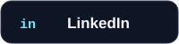</a>
  

  

  

  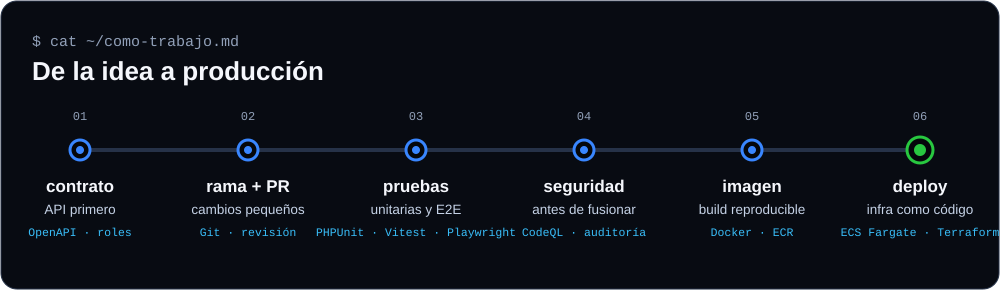

## Proyectos

  <a href="https://urbanblade.com.mx/">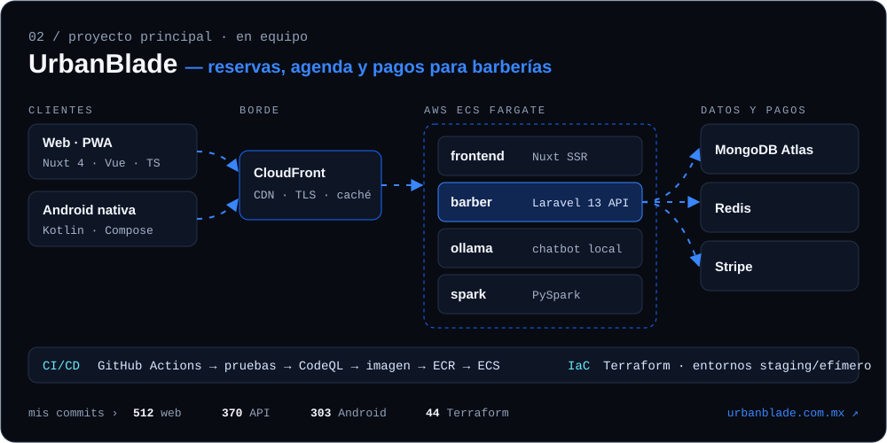</a>

**UrbanBlade**, plataforma de reservas, agenda, pagos e inventario con paneles por rol. Proyecto en equipo donde llevo API, web, Android, infraestructura y pipelines:
[API](https://github.com/KikeGonRam/barber) · [Web](https://github.com/KikeGonRam/frontend_Urbanblade) · [Android](https://github.com/al140605/UrbanBladeMobile) · [Terraform](https://github.com/al140605/barberterraform) · [CI](https://github.com/KikeGonRam/urbanblade-ci) · [Analítica](https://github.com/KikeGonRam/spark)

  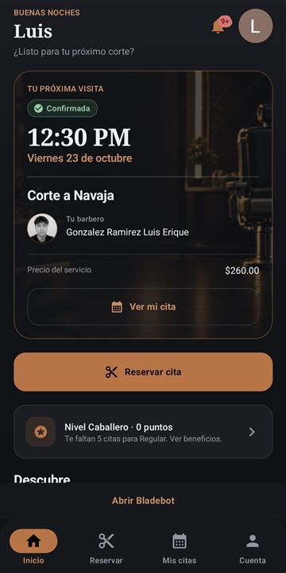
  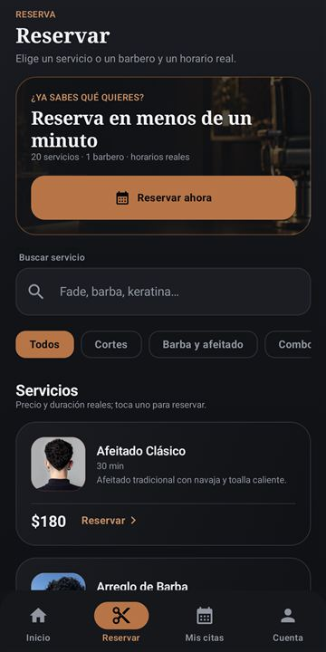
  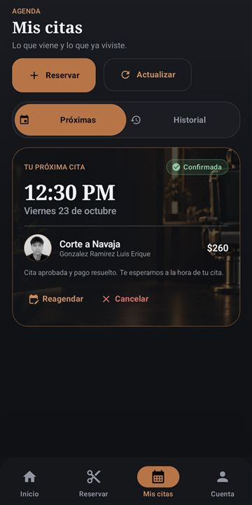

  <a href="https://github.com/KikeGonRam/dbmonitor">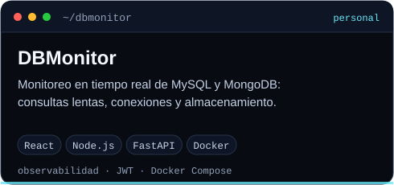</a>
  <a href="https://github.com/KikeGonRam/RAG">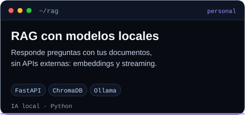</a>
  <a href="https://github.com/KikeGonRam/vulncore">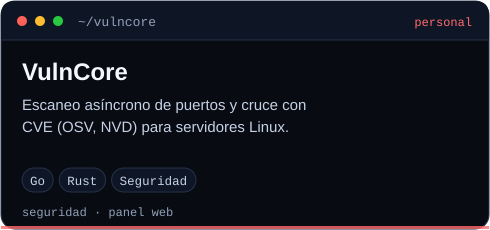</a>
  <a href="https://github.com/KikeGonRam/evaluacion-docente-api">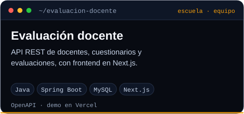</a>

  

## Stack

| | |
|:--|:--|
| **Backend** |  |
| **Frontend** |  |
| **Móvil** |  |
| **Datos** |  |
| **Cloud y DevOps** |  |

  

Verificación: <a href="https://www.credly.com/badges/6b6503ba-8c58-4927-a820-5750b08b165d">AWS en Credly</a> · Cisco en <a href="https://www.netacad.com">Networking Academy</a>

## Ahora mismo

- Llevando UrbanBlade de staging a producción en AWS, con despliegues automatizados.
- Estudiando Ingeniería en Desarrollo y Gestión de Software en la UTVT.
- Abierto a proyectos y vacantes de backend, full-stack o DevOps.

---

KIKEGONRAM · IDEAS CLARAS. CÓDIGO CON CARÁCTER.

