<p align="center">
  
</p>

```bash
┌─[ kikegonram@github ]─────────────────────────────[~]
└─➜ whoami

  luis-enrique · @KikeGonRam
  dev fullstack — web · móvil · IA local
  méxico 🇲🇽 · abierto a colaborar
```

```bash
┌─[ kikegonram@github ]─────────────────────────────[~]
└─➜ ls ~/proyectos --destacados

  urbanblade/     sistema fullstack para barbería (prod)
  rag-local/      IA que responde con TUS documentos, sin nube
  vulncore/       laboratorio de seguridad / vulns
```

```bash
┌─[ kikegonram@github ]─────────────────────────────[~]
└─➜ cat stack.txt

  lenguajes     python · javascript · sql
  web           react · node · apis rest
  móvil         android / multiplataforma
  ia            rag local · embeddings · llms
```

```bash
┌─[ kikegonram@github ]─────────────────────────────[~]
└─➜ ./hablemos.sh --sobre-tu-proyecto

  📧  kikeramirez160418@gmail.com
  🔗  kikegonram.github.io        ← portafolio
  💼  linkedin.com/in/luisgonzalezramirez-dev
  🌐  urbanblade.com.mx
```

<p align="center">
  <a href="https://kikegonram.github.io"></a>
  <a href="https://www.linkedin.com/in/luisgonzalezramirez-dev"></a>
  <a href="mailto:kikeramirez160418@gmail.com"></a>
</p>

<p align="center">
  
  
</p>

<p align="center"><sub>➜ exit 0 · KIKEGONRAM · IDEAS CLARAS. CÓDIGO CON CARÁCTER.</sub></p>
