  

  
  
  

  

**UrbanBlade:** [Sitio web ↗](https://urbanblade.com.mx/) · [Frontend](https://github.com/KikeGonRam/frontend_Urbanblade) · [Backend / API](https://github.com/KikeGonRam/barber)

**Más código:** [RAG local](https://github.com/KikeGonRam/RAG) · [vulncore](https://github.com/KikeGonRam/vulncore) · [Todos mis repositorios](https://github.com/KikeGonRam?tab=repositories)

**[Hablemos de tu proyecto ↗](mailto:kikeramirez160418@gmail.com)** · [Portafolio](https://kikegonram.github.io) · [LinkedIn](https://www.linkedin.com/in/luisgonzalezramirez-dev)

  
  

---

KIKEGONRAM · IDEAS CLARAS. CÓDIGO CON CARÁCTER.

